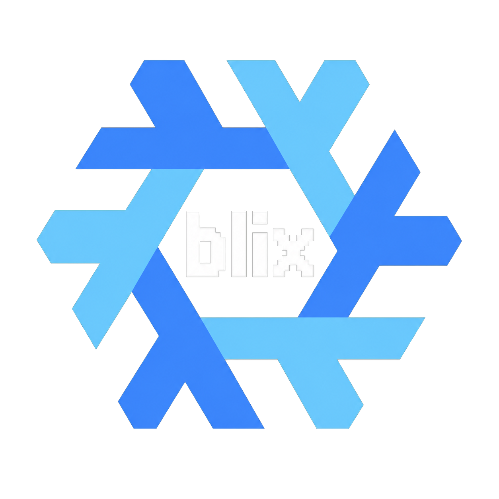

<p align="center">
  
</p>

# blix

Declarative NixOS and Home Manager configuration for the `przvl` user. The
flake defines `zen`, `t490`, and a OnePlus 6T `phone`, with the same
Blix-style OXWM desktop session. The phone's bootstrap physically booted on
2026-10-14; its installed native boot and accelerated OXWM/Ghostty desktop were
verified on 2026-10-15. See the phone section for the latest startup verification
status and remaining hardware issues.
Its independent user composition lets its applications and environment evolve
separately from the workstations.

The desktop uses:

- Zen and T490 start Xorg manually with `startx`. The phone logs in as `przvl`
  and starts Xorg automatically on tty1; none uses a display manager.
- OXWM is the window manager, with the Blix configuration and local patches.
- Ghostty, `dmenu`, `picom`, `xsecurelock`, `xss-lock`, `clipmenu`, and Xfe provide
  the terminal, launcher, compositor, locking, clipboard, and file-manager
  pieces.
- Ghostty runs Bash with ble.sh for interactive editing, highlighting and
  completion. Home Manager manages its settings and Bash integration; OXWM's
  terminal binding uses the same executable as `$TERMINAL`.
  Clicking within the current shell command moves the editing cursor there.
  Ctrl-click opens links in Firefox; use Ctrl-Shift-click when a terminal
  application captures the mouse.
- Home Manager creates the user services and scripts for display hotplugging,
  locking, clipboard history, screenshots, brightness, status, and audio.
- Blix Settings is a native GTK app for display, audio, Bluetooth, networking,
  power and input controls. `Super+S` opens or focuses its window.
- Firefox is managed with the Blix privacy policies and force-installed uBlock
  Origin, Dark Reader, and Enhancer for YouTube extensions. Its default profile
  includes the captured privacy preferences, vertical tabs, square corners,
  JetBrains Mono fonts, and dark PDF pages.
- Neovim uses LazyVim with the minimal theme and absolute line numbers.
  `nvimide [project-directory]`
  adds a left explorer and two stacked terminals on the right, with Neofetch
  in the second terminal. Plain `nvim` keeps the normal editor layout.
- tmux is installed with its upstream defaults, without a Blix configuration
  or custom layout launcher.

Firefox and Neovim configuration lives in `home/przvl/config/`; the application
modules own the Home Manager integration for these local files.
The Neovim adapter uses Nix-packaged Lua language server, StyLua and shfmt in
place of Mason downloads, and preserves the writable lazy.nvim lockfile.

## Repository map

```text
flake.nix                         Inputs, host composition, and checks
flake.lock                        Pinned nixpkgs, Home Manager, official Codex bundles and Mobile NixOS
lib/mk-host.nix                   Platform, overlays, and Home Manager wiring
overlays/desktop.nix              OXWM patches and the Neofetch package
overlays/codex.nix                Install complete official Codex release bundles

profiles/
├── laptop.nix                    Shared workstation environment and laptop defaults
├── desktop.nix                   Shared workstation environment and desktop defaults
└── phone.nix                     Independent phone system and user composition

modules/boot/uefi.nix             Optional UEFI/systemd-boot defaults

modules/common/
├── default.nix                   Shared foundation without a desktop environment
├── boot.nix                      Bootloader-independent kernel policy
├── home-manager.nix              Home Manager wiring and shared user identity
├── locale.nix                    Locale and timezone
├── machine.nix                   Typed capabilities and Home Manager bridge
├── networking.nix                NetworkManager
├── nix.nix                       Nix version, flakes, GC, and optimization
├── packages.nix                  Shared system utilities
└── users.nix                     Shared user definitions

modules/desktop/
├── default.nix                   Optional desktop environment composition
├── session.nix                   X11, startx, and OXWM
├── services.nix                  Graphics, PipeWire, polkit, rtkit, and Blueman
├── fonts.nix                     Desktop fonts
└── packages.nix                  X11 utilities and graphics diagnostics

modules/hardware/
├── default.nix                   Session-independent Bluetooth and power policy
├── x11.nix                       Desktop input module composition
├── keyboard.nix                  Keyboard layout and repeat defaults
├── keyboards/mechanical.nix      Device-specific Cmd/Super mapping
├── mouse.nix                     Natural scrolling for ordinary mice
├── touchpad.nix                  Natural scrolling and click/tap defaults
├── power.nix                     Capability-based lid policy
└── bluetooth.nix                 Capability-based Bluetooth support

hosts/<host>/
├── default.nix                   Profile inheritance and hardware quirks
├── hardware-configuration.nix    Generated hardware facts
├── home.nix                      Machine-dependent Home Manager composition
└── display.nix                   Host display connectors and scaling

hosts/phone/
├── default.nix                   ARM fajita host selecting the normal phone profile
├── hardware.nix                  Mobile NixOS hardware, boot, firmware and rootfs
├── input.nix                     Phone Bluetooth modifier and touchscreen rotation
├── bootstrap.nix                 Temporary USB networking and key-only USB/Wi-Fi SSH
├── bootstrap.pub                 Public key for temporary installation access
├── bootstrap-system.nix          Small installation userspace, without the desktop
├── home.nix                      Machine-dependent user composition
└── display.nix                   Verified DSI-1 panel in landscape orientation

home/przvl/
├── base.nix                      Shared identity, state version and capabilities
├── default.nix                   Workstation user composition for zen and t490
├── phone.nix                     Independent phone application and session choices
├── environments/oxwm.nix         Reusable OXWM services, helpers and settings
├── hardware/
│   ├── default.nix               Typed user capabilities
│   ├── bluetooth.nix             Bluetooth manager and session pairing agent
│   ├── display.nix               Display options, helper package and service
│   └── display-hotplug.sh        Mirroring, extension and reconnect behavior
├── packages.nix                  Reusable command-line package selection
├── programs/                     Bash, Firefox, Git, Neovim, tmux, and tools
├── services/blix.nix              Blix session target and user services
├── scripts/blix.nix               Wrapped Blix scripts
├── x11.nix                       Dotfiles and generated ~/.xinitrc
└── config/                       OXWM, Picom, Xfe, Neovim, and script assets

packaging/
├── blix-settings/                Native settings app, backends and GTK styling
├── oxwm/                         Patches applied to the pinned OXWM release
└── neofetch/                     Pinned Neofetch and NixOS compatibility fixes

tests/
├── default.nix                   Checks for x86_64-linux and aarch64-linux
├── profile-fixture.nix           Synthetic hardware for evaluation/build checks
├── machine-profiles.nix          Profile defaults and hardware overrides
├── environment-composition.nix   Shared foundation and phone environment replacement
├── phone-hardware.nix            Real fajita/bootstrap integration assertions
├── keyboard-mapping.nix          Compiled built-in and mechanical keymaps
├── keyboard-mapping.py           Win/Cmd modifier regression checks
├── display-hotplug.py            Monitor, rotation, scaling, and reconnect checks
├── blix-settings.nix             Settings backend and isolated GTK checks
└── session-settings.nix          Generated blanking and Xresources behavior
```

## Machine profiles

Each host imports a profile from `profiles/`, plus its hardware module. Every
profile includes `modules/common`; hosts do not need to import it separately.
The common foundation selects no desktop, GUI applications, display connector,
or user-session services. Profiles explicitly choose their system environment
and Home Manager composition.

`zen` and `t490` inherit the laptop profile and share `home/przvl/default.nix`.
The desktop profile uses that workstation composition too. The phone profile
selects `home/przvl/phone.nix`, which chooses reusable application modules
individually and does not import the workstation composition. All three profiles
currently opt into `modules/desktop` and `home/przvl/environments/oxwm.nix` to
preserve the existing environment. Profiles supply defaults, shared modules
implement capability-based behavior, and hosts supply facts and exceptions.

| Default | Laptop | Desktop | Phone |
| --- | --- | --- | --- |
| `blix.machine.type` | `"laptop"` | `"desktop"` | `"phone"` |
| `hasBattery`, `hasBacklight` | `true` | `false` | `true` |
| `hasTouchpad`, `hasLid` | `true` | `false` | `false` |
| `hasBluetooth` | `true` | `false` | `true` |
| Lid close, on battery or external power | Suspend | Ignore | Ignore |
| Lid close while docked | Ignore | Ignore | Ignore |
| `blix.display.layout` | `"mirror"` | `"extend"` | `"extend"` |
| `blix.display.blankAfterSeconds` | `0` | `0` | `300` |
| Boot provider | UEFI/systemd-boot | UEFI/systemd-boot | Supplied by hardware layer |

Capabilities are typed NixOS options under `blix.machine` and can be overridden
in `hosts/<host>/default.nix`. For example, a laptop without a controllable
panel backlight can set `blix.machine.hasBacklight = false`. The system passes
battery and backlight capabilities to Home Manager automatically. Desktop
profiles omit battery widgets, Neofetch battery reporting, and battery/brightness
helpers; brightness bindings are only registered when a backlight is enabled. Battery
reporting still checks for actual hardware at session startup. Lid behavior
uses `hasLid`, independently of the profile's name. Bluetooth support enables
BlueZ and powers the controller on at boot. The selected desktop supplies Blueman
and the user session supplies its pairing agent.
The Blueman pairing agent starts with the Blix X11 session without requiring a
system tray. Launch `blueman-manager` from dmenu or a terminal to pair, trust and
connect devices. Pairing records stay on the machine; hosts can opt out with
`blix.machine.hasBluetooth = false`.
The phone disables Blueman's connection/disconnection popups; other hosts keep
their existing notification behavior.

Charge thresholds, Wi-Fi power quirks, and panel-driver workarounds remain
host-specific. The profiles share manual suspend and locking before suspend.
The phone profile also enables zram and UPower, requests orderly shutdown at 3%
battery, and makes a short power-button press lock the session. The phone has
no automatic idle lock, suspend or display power-off; use the software controls
or power button explicitly. Its display timeout defaults to zero, and logind
ignores idle sessions. Other profiles leave automatic suspend to verified host
policy. Hosts can override individual logind defaults through
`services.logind.settings.Login`.

Keyboard, mouse, touchpad, lid and Bluetooth policy live in separate files under
`modules/hardware/`. Natural scrolling applies to ordinary mice and all touchpads,
including external touchpads on desktop and phone hosts using the X11 environment.
The shared foundation includes only power and Bluetooth policy; the desktop
selects keyboard, mouse and touchpad policy through `modules/hardware/x11.nix`.
Pointing sticks and tablets retain their existing behavior. `hasTouchpad` enables
the additional tap and click defaults; scrolling can be overridden with
`services.libinput.touchpad.naturalScrolling`.

`keyboards/mechanical.nix` matches USB ID `1fc9:e8c7` and swaps Alt/Super for that
keyboard's Mac-mode Cmd key. Built-in laptop Win keys retain Super. Xorg applies
the rule when the device connects; no keyboard hotplug daemon or Xorg log parsing
is needed. New device-specific mappings belong alongside that module.

Display behavior and its dedicated hotplug service live in
`home/przvl/hardware/display.nix` and `display-hotplug.sh`. Display facts live in
`hosts/<host>/display.nix`, imported by the host's `home.nix`. Each host using the
X11 environment supplies `blix.display.primaryOutput`: an internal connector such
as `eDP-1` on a laptop, or a monitor connector such as `DP-1` on a desktop. Extended
layouts use preferred modes and place other connected monitors to the right of the
primary monitor. Mirrored layouts use `externalOutput` and
`additionalExternalOutputs`, with `mirrorMode` defaulting to `1920x1080`.
For each display, the helper selects the highest advertised refresh rate at the
chosen resolution: the preferred resolution for extended/undocked displays,
and `mirrorMode` for mirrored displays. Rates are selected independently, so a
slower monitor does not impose its rate on the others. `mirrorRate` defaults to
`null` for automatic selection; setting a value such as `"60"` explicitly pins
mirrored rates. If a driver rejects a selected rate, the helper retries the same
resolution with automatic refresh selection. It reapplies newly advertised
rates while ignoring duplicate events and changes to the active-mode marker.
`primaryScaleFrom` optionally sets a logical resolution
for the primary display outside mirrored operation. Hosts can override the
inherited layout, so a laptop can use extended monitors too.

`primaryRotation` accepts `"normal"`, `"left"`, `"right"`, or `"inverted"`.
Rotation is reapplied on startup and reconnect. `dpi` optionally sets X11,
Xft and GTK font/UI sizing; it defaults to `null` so existing hosts retain
their current sizing. Font changes may require restarting applications.
Rotation and DPI are host facts, rather than assumptions in the phone profile.
`primaryOutput = null` selects the first connected output at runtime. The phone
uses the observed `DSI-1` connector with left rotation and 192 DPI.
`blankAfterSeconds` controls idle DPMS display power-off; `0` disables it.

A desktop's `display.nix` can be as small as:

```nix
{ ... }:
{
  blix.display.primaryOutput = "DP-1";
}
```

## Blix Settings

Open `blix-settings` from a terminal or launcher, or press `Super+S`. The app
uses the existing NetworkManager, BlueZ, PipeWire/PulseAudio and X11 services;
it also includes a searchable shortcut reference and system information.

- Display controls cover mirror/extend layouts, monitor positions, resolutions,
  each output's advertised refresh rates, rotation, scaling and brightness.
  Applying a layout starts a 15-second confirmation window. A separate watchdog
  restores the previous layout if it is rejected, times out or the app closes.
  Window transparency applies immediately: on keeps the usual 85% focused / 80%
  unfocused opacity and opaque Firefox video windows; off makes every window
  100% opaque. Picom keeps running, and the choice persists across sessions.
  Night light controls Gammastep with an on/off switch and a 0–100% intensity
  slider (6500K neutral to 2500K warm). Apply intensity saves the slider choice;
  switching off fully resets color adjustment. Choices persist across sessions.
- Audio controls select speakers and microphones, adjust volume and mute,
  play a test tone, and show an optional microphone level meter without recording.
- Bluetooth supports discovery, pairing confirmation, connection and forgetting
  devices. Networking supports Wi-Fi passwords, saved profiles and Ethernet
  status. Advanced Connections opens NetworkManager's editor for VPNs,
  enterprise authentication and detailed connection settings.
- Power shows battery and charge-limit information, configures display idle
  time, and offers locking and suspend. Input controls configure pointing-device
  speed, natural scrolling, touchpad tapping and keyboard repeat.

Nix supplies immutable, capability-based defaults in `~/.config/blix/defaults.json`.
User choices live separately in `~/.config/blix/settings.json`; Restore Defaults
removes the corresponding override. Display preferences are reapplied by the
existing hotplug helper, and saved input preferences return when matching
devices reconnect. NetworkManager owns Wi-Fi credentials and connection profiles;
BlueZ owns pairing records. Neither is copied into the settings file.

`blix-settings --demo` previews the interface with sample devices and in-memory
preferences. It does not change hardware or saved settings.

## Starting the session

On Zen and T490, log into a local TTY as `przvl`, then run:

```sh
startx
```

The full phone host enables getty autologin as `przvl` and invokes `startx`
automatically on tty1. Its login-file guard leaves SSH, other TTYs and terminal
windows as ordinary shells. The small installation bootstrap retains manual
login and does not include Xorg.

The generated `~/.xinitrc` starts the user session target, initializes the
configured displays, starts Picom and the Blix helper services, and finally
executes OXWM. The display helper uses these environment variables, populated
from the host options:

```text
BLIX_DISPLAY_LAYOUT
BLIX_PRIMARY_OUTPUT
BLIX_PRIMARY_ROTATION
BLIX_DISPLAY_DPI
BLIX_EXTERNAL_OUTPUT
BLIX_ADDITIONAL_EXTERNAL_OUTPUTS
BLIX_MIRROR_MODE
BLIX_MIRROR_RATE
BLIX_PRIMARY_SCALE_FROM
BLIX_WALLPAPER
```

Firefox's local Blix Video Opacity extension marks a window's title with
`[blix-video]` while its active tab plays an HTML video, including embedded
videos and private windows. Picom makes only marked Firefox windows opaque;
pause, completion, navigation and tab switching restore ordinary transparency.
Tabs on x.com and its subdomains keep ordinary transparency, including when
they play videos in embedded frames. The detector also skips x.com documents.
The extension uses playback events and an idle-unloading background page, with
no polling or separate service. Shared Home Manager configuration loads its
immutable Nix package as a trusted built-in through Firefox AutoConfig; normal
addon signature checks and the web-content sandbox remain enabled. Its sources
live in `home/przvl/config/firefox/video-opacity/`; bump `manifest.json`'s version
when updating it. The isolated `firefox-video-opacity` check exercises playback,
window/tab/frame lifecycle, browser restarts and Picom's rendered opacity.

To leave the session, exit OXWM or use the configured lock/power controls and
return to the TTY.

## Adding a host

1. Create `hosts/<hostname>/` and generate its hardware module with
   `nixos-generate-config --show-hardware-config`.
2. Import the appropriate laptop, desktop, or phone profile and the hardware
   module from the host's `default.nix`. Supply any additional boot provider.
3. Set the hostname, the state version of that machine's installation, hardware
   quirks, capability overrides, and host-specific networking settings there.
   Connect its `home.nix` with `home-manager.users.przvl = import ./home.nix;`.
4. For the X11 environment, set `blix.display.primaryOutput` and any other display
   values in `display.nix`, and import that file from `home.nix`.
5. Register the host in `flake.nix`:

```nix
nixosConfigurations = {
  zen = mkHost { modules = [ ./hosts/zen ]; };
  t490 = mkHost { modules = [ ./hosts/t490 ]; };
};
```

An ARM host sets `system = "aarch64-linux"` in `mkHost`. The real phone also
passes `specialArgs = { inherit mobile-nixos; };` to its hardware module.
Profiles choose capabilities; the host constructor chooses the package platform.

## OnePlus 6T phone

`profiles/phone.nix` owns phone system policy and chooses its system environment.
`home/przvl/phone.nix` independently selects phone applications, reusable program
configuration and user-session modules. The initial selection retains OXWM,
Xorg, Ghostty, dmenu, Firefox and Neovim. Workstation application additions in
`home/przvl/default.nix` or `home/przvl/programs/default.nix` do not automatically
reach the phone. Changes to an individual reusable program module still affect
every composition that imports it.

Put phone-specific applications and user behavior in `home/przvl/phone.nix` or
focused modules it imports. It can omit shared command-line packages or choose
different program modules without replacing the workstation's package list.
For a different session, replace the `modules/desktop` import in the phone system
profile and the `environments/oxwm.nix` import and desktop-specific application
and appearance modules in the phone user composition together. Replace X11-specific
display settings such as `blix.display.blankAfterSeconds` as part of that change.
The shared foundation remains usable without X11, a display connector or Blix
user services.

The profile selects no architecture, kernel, firmware, bootloader, partition
layout, display connector or rotation. `hosts/phone/hardware.nix` imports the
locked Mobile NixOS `oneplus-fajita` device layer; `flake.nix` selects
`aarch64-linux`. This is regular NixOS userspace with a device-specific kernel
and first-stage boot implementation. No Phoneputer desktop configuration,
GNOME, Phosh, Plasma Mobile or Ubuntu Touch environment is imported.

This preparation follows [Phoneputer](https://github.com/mwlaboratories/phoneputer),
the [6T fork](https://github.com/rinnvxv/phoneputer), and
[upstream fajita support](https://mobile.nixos.org/devices/oneplus-fajita.html).
The lock pins Mobile NixOS at `2c132754323fc1915e8d21dcfc0ef68ab084c6fb`,
which still selects the SDM845 `6.4.0` kernel and declares best-effort support.
The fork's examples use GNOME/PulseAudio and a default root password; its README
and `local.nix` disagree on that password. They are references for the hardware
workflow, not configurations to copy into Blix. Existing Blix inputs retain
their revisions; Phoneputer itself is not a build dependency.

| Boundary | Phone configuration and verification |
| --- | --- |
| Bootloader | Android A/B boot image; no GRUB, UEFI or systemd-boot. An external loader hook reports that boot partitions are managed separately. |
| Kernel and initrd | Upstream SDM845 kernel and Mobile stage-1. No PC kernel modules or generated laptop hardware file. No stage-0/kexec support. |
| Firmware | Upstream OnePlus firmware plus the 6T's pinned TFA9894 speaker container, and Qualcomm support services. Only the OnePlus firmware package and its zstd wrapper are permitted as unfree. |
| Filesystem | Generated ext4 image labeled `NIXOS_SYSTEM`, intended for existing `userdata`. No invented UUID or `/boot`. Filesystem auto-resize is enabled; GPT/partition growth is disabled. |
| Audio | PipeWire with a phone-local O6T HiFi speaker profile. MultiMedia3 feeds the TFA9894 amplifier; WirePlumber excludes the kernel Loopback card. Microphone, headset and call routing remain unverified. |
| Networking | Ordinary NetworkManager with Wi-Fi power saving disabled on this device as a provisional workaround for intermittent link stalls. The temporary USB profile is in `bootstrap.nix`; no competing wireless daemon, stage-2 phone DHCP server or embedded Wi-Fi password. |
| Bluetooth and input | BlueZ, Blix's Blueman pairing agent, and touchpad defaults for the folding keyboard. Pairing state stays on the phone; mechanical USB key remapping does not apply to Bluetooth. |
| Graphics | Xorg/Mesa/OXWM on verified DSI-1, 2340×1080 landscape at 60 Hz, with FD630 hardware acceleration. Touchscreen coordinates follow the selected rotation. |
| Users | Shared `przvl` identity and Home Manager state `26.05`; system state `26.11`. The full phone automatically logs in as `przvl` and starts X on tty1. A local password is still used for locking and administrative commands. |

The Wi-Fi workaround may increase battery use; its effect on the intermittent
failures and battery life still needs longer observation.

The pinned upstream firmware package lacks `tfa98xx.cnt`; the initial boot
confirmed the speaker driver's load failed with `ENOENT`. The phone hardware
module adds the [OnePlus 6T vendor container](https://github.com/TheMuppets/proprietary_vendor_oneplus_fajita/blob/91bb0ea54fb0870c0b3ec2bc1c584ee456206cdf/proprietary/vendor/etc/firmware/tfa98xx.cnt)
with a fixed checksum to the device firmware used by both stages. The built-in
codec requests it in stage-1, so installing this fix requires the corresponding
boot image as well as userspace. The installed image contains this blob and the
missing-firmware error is gone. The pinned upstream UCM package also lacks a
matching 6T profile. `hosts/phone/audio.nix` melds the local `ucm2/` speaker
profile into that tree and excludes the kernel Loopback card from WirePlumber.
The speaker uses `hw:O6T,2` (MultiMedia3) through QUAT_MI2S_RX, following the
[SDM845 fajita profile](https://gitlab.com/sdm845-mainline/alsa-ucm-conf/-/blob/9ed12836b269764c4a853411d38ccb6abb70b383/ucm2/OnePlus/fajita/HiFi.conf).
The running phone exposes this HiFi speaker sink and the amplifier starts
successfully during a low-volume test; audible confirmation is pending.
The local profile deliberately covers speaker playback only. It does not
claim microphone, headset, or call support. This is a userspace-only change;
it requires no new boot image. Use the staged update workflow below for
persistence; a targeted WirePlumber restart can test the audio configuration
without restarting the Qualcomm networking services.

The synthetic `checks.aarch64-linux.phone-system` still uses fake storage and
UEFI solely for composition tests. **Never flash or activate that fixture.**
Use the actual phone outputs below. Evaluation, successful builds, and the
`phone-hardware` assertions do not establish that this physical 6T will boot.

### Build before device preparation

From this repository on the T490, inspect the connected device with pinned tools:

```sh
nix shell --inputs-from . nixpkgs#android-tools nixpkgs#usbutils
lsusb
adb devices -l
fastboot devices
```

On 2026-10-14, stock Android ADB identified this phone as **ONEPLUS A6010**,
running OxygenOS **11.1.2.2 / Android 11**, build `ONEPLUS A6010_41_211125`,
on slot **B**. After the authorized unlock and factory reset, fastboot confirmed
`unlocked=yes`, 64 MiB boot partitions and a 118,112,366,592-byte userdata
partition. Official fajita Lineage Recovery also boots on this device. These
observations verify device preparation. The NixOS bootstrap then booted kernel
`6.4.0` on aarch64, accepted key-only root SSH over USB, and resized the root
filesystem within userdata to 108.2 GiB. Full desktop and peripheral validation
remain separate checks. A charging indicator alone does not establish a working
USB data connection.

On 2026-10-15, the real native phone system and Android boot image from revision
`b74fa13` passed a temporary RAM boot and a normal installed boot. Both boot
slots read back the image's SHA-256, and the default profile and running system
select the full phone generation. Home Manager activation, fresh key-only
Wi-Fi SSH and zero failed system services were verified. The ARM composition
fixture and ARM session-settings check also built successfully. The image is
37,625,856 bytes with SHA-256
`cf32916e374903eb4f837890ece7d20084d930920b6518402f891090d332d902`.
OXWM and Ghostty were observed on the physical panel, with direct rendering on
the Adreno 630. The Bluetooth keyboard reconnects, and landscape rotation was
tested. Audible output and suspend/resume still require physical validation.

The initial live userspace switch stopped the Qualcomm modem/network services;
the kernel then reported ath10k timeouts and unavailable Wi-Fi hardware during
restart. Saved journals confirmed that the installation guard rolled back.
A cold boot restored Wi-Fi. Use the staged boot/reboot workflow below on this
kernel; preserve `/var/log/blix-phone-native-activation.log` and the kernel and
NetworkManager journals when investigating a failed activation.

The phone-only startup and display configuration was physically verified on
2026-10-15. The running system and default profile select the corrected
generation; getty logs in `przvl` and starts OXWM automatically on tty1.
The desktop uses 2340×1080 landscape, 192 DPI, the forest wallpaper and a 22 pt
Ghostty font. The user confirmed automatic desktop startup and readable terminal
text. Home Manager activated successfully, temporary preview units were absent,
and no system or user services were failed.

Home Manager's explicit Bash login-file source had ignored the first text
override. The corrected `programs.bash.profileExtra` hook passed checks that
execute the generated login files on x86 and ARM, along with full flake,
all-system and native ARM checks. Zen/T490's system derivations remain identical.

One warm reboot after staging entered Qualcomm USB `05c6:900e` crash mode.
A physical force restart restored normal boot into the corrected generation.
The previous journal ends at the reboot request and `/sys/fs/pstore` is empty,
so the cause remains unresolved. The kernel, initrd and boot partitions were
unchanged by these preference updates; the earlier full native generation
remains available for recovery. Linux SSH is unavailable in crash mode. Recover
with a physical force restart, then inspect the previous journal and pstore
before changing firmware; the USB mode alone does not identify the cause.

Evaluate the actual host and build the small cross-compiled installation image:

```sh
nix eval .#nixosConfigurations.phone.config.system.build.toplevel.drvPath --raw
nix build .#packages.x86_64-linux.phone-bootstrap-images --out-link result-phone-bootstrap
ls -lh result-phone-bootstrap/
sha256sum result-phone-bootstrap/boot.img result-phone-bootstrap/system.img
sed -n '1,200p' result-phone-bootstrap/flash-critical.sh
```

The final command **reads** the generated script; do not execute it. The script
writes both boot slots. The small bootstrap replaces the profile's desktop and
phone application composition and extra CLI/documentation packages while
keeping the shared foundation, real device layer, `przvl` user, Git, Nix,
NetworkManager and temporary SSH. It is not the final
Blix desktop. Cross-compilation may expose package/build incompatibilities even
when evaluation succeeds; do not proceed with an incomplete build.

On an ARM machine, or from a machine with a configured ARM builder, build the
native bootstrap and full phone closure/images with:

```sh
nix build .#packages.aarch64-linux.phone-bootstrap-images --out-link result-phone-bootstrap-native
nix build .#nixosConfigurations.phone.config.system.build.toplevel --no-link
nix build .#packages.aarch64-linux.phone-fastboot-images --out-link result-phone
```

The T490 currently has no ARM builder or emulation. The x86 bootstrap output
uses an x86 builder to cross-compile ARM code; the full desktop output requires
an ARM builder. Both use the same locked nixpkgs and Mobile NixOS inputs.

### Recovery and firmware preparation

Follow the [official fajita installation guide](https://wiki.lineageos.org/devices/fajita/install/)
and the locked Mobile NixOS device notes before installing the mainline images.
The recovery boot image and DTBO must come from the same official fajita build;
verify their sizes and SHA-256 values against the LineageOS download API.
This device used the 2026-10-13 LineageOS 22.2 recovery, installed to the verified
active slot B with `flash dtbo_b`, a bootloader restart, then `flash boot_b`.
The recovery is temporary; Blix's boot images replace it later.

Enter recovery using the phone's fastboot menu: press a volume button until
`START` changes to `Recovery mode`, then press Power once. On this 6T,
`fastboot reboot recovery` returned OKAY but stayed in fastboot. In Lineage
Recovery, choose **Advanced → Enable ADB** to get a maintenance shell. Android's
previous debugging authorization does not enable recovery ADB. Repeat this
toggle after restarting recovery or completing a sideload.

Verify `adb shell getprop ro.boot.slot_suffix` still reports `_b` before copying
firmware from the known Android 11 slot. Save SHA-256 baselines for the paired
firmware partitions and backups of the small bootloader partitions. This
phone's initial comparison found 18 differing pairs out of 28, so merely
checking that both slots are bootable does not establish firmware consistency.
Use the official
[`copy-partitions-20220613-signed.zip`](https://mirrorbits.lineageos.org/tools/copy-partitions-20220613-signed.zip)
through **Apply update → Apply from ADB**, followed by `adb sideload`.
With maintenance ADB already enabled, `adb reboot sideload` also enters this
mode. The package copies active-slot firmware to the inactive slot and excludes
boot, DTBO, system and vbmeta; it does not alter the GPT.

After sideloading, choose **Advanced → Reboot to recovery**, then enable ADB
again. Verify all copied A/B partition hashes against the saved active-slot
baseline before flashing NixOS. A completed ADB transfer alone does not verify
the writes. Preserve the existing GPT and use `userdata` for the Blix rootfs.
On this phone, all 28 pairs were read back after the copy and matched the saved
original slot B hashes.

The T490's TLP USB autosuspend caused this fastboot device to return spurious
`unknown command` responses after idling. Start the serial-specific helper
**before entering fastboot**, and keep it running during the installation:

```sh
systemd-run --user --unit=blix-phone-usb-keepawake --collect \
  --property=RuntimeMaxSec=30min \
  "$(command -v python3)" "$PWD/hosts/phone/usb-keepawake.py" \
  --serial '<serial from fastboot devices>' --seconds 1800
```

The helper uses existing USB device permissions, keeps a USBFS descriptor open
only for the matching serial in fastboot, and reacquires it after a USB
reenumeration. It claims no interface and sends no flashing commands. Its
suspend inhibition ends when the descriptor closes; TLP configuration is not
changed. Start a fresh bootloader session if it already entered the faulty
state. Stop the helper after installation with
`systemctl --user stop blix-phone-usb-keepawake.service`.

### Device inspection and installation authorization

Before changing anything on the phone, establish an authorized ADB connection
and record these read-only facts when available:

```sh
adb -d shell getprop ro.product.device
adb -d shell getprop ro.product.model
adb -d shell getprop ro.build.display.id
adb -d shell getprop ro.build.version.release
adb -d shell getprop ro.boot.flash.locked
adb -d shell getprop ro.boot.slot_suffix
adb -d shell getprop ro.boot.verifiedbootstate
adb -d shell cat /proc/partitions
```

When the user has separately placed the phone in its bootloader, read:

```sh
fastboot getvar product
fastboot getvar unlocked
fastboot getvar current-slot
fastboot getvar slot-unbootable:a
fastboot getvar slot-unbootable:b
fastboot getvar partition-size:boot_a
fastboot getvar partition-size:boot_b
fastboot getvar partition-size:userdata
```

Verify the actual fajita variant, backup/restore plan, bootloader eligibility,
image sizes/checksums, and the OxygenOS 11 and consistent A/B firmware
prerequisites in upstream's device notes. Do not substitute an enchilada image.
Unlocking, firmware updates, recovery sideloads and `copy-partitions` payloads
must be covered by the user's installation authorization. Honor authorization
already given for the full workflow; do not request it again for each command.
An installation guide or a generated script alone does not grant authorization.

After verifying those facts, the completed image build, and all 28 copied
firmware pairs, this mainline-only bootstrap sequence completed on 2026-10-14:

```sh
fastboot erase dtbo_a
fastboot erase dtbo_b
fastboot --slot=all flash boot result-phone-bootstrap/boot.img
fastboot flash userdata result-phone-bootstrap/system.img
```

Both boot-slot writes and all six automatically generated sparse userdata
transfers returned OKAY. The installed bootstrap artifacts were:

| Image | Bytes | SHA-256 |
| --- | --- | --- |
| `boot.img` | 36,892,672 | `2165a09827d62f64fcfac48a855937771f9bffb28a7c6e2f7f29bb91b62ec256` |
| `system.img` | 5,161,934,848 | `e825c5e182b1969a1ed801576d9a7908f36cd682b104e939f1e5cd12af7f18ba` |

Review each exact device-writing command against the authorized scope before
executing it. Flashing `userdata` replaces Android user data with the rootfs; the
image resizes that filesystem within its existing partition on first boot.
Upstream boot-control also marks successful A/B boots in device metadata.
Do not run a flashing script, reformat/erase userdata redundantly, modify the
GPT layout, or sideload a partition-writing ZIP outside the authorized scope.
The first NixOS boot and key-only SSH access succeeded after this installation.

### USB bootstrap and ordinary Blix deployment

`bootstrap.nix` enables USB networking in stage-1 and a NetworkManager manual
profile on the observed phone interface `usb0` in stage-2. It explicitly marks
`usb0` as managed, overriding NetworkManager's default udev rule that ignores
USB gadget interfaces. Verify the active profile: NetworkManager has also been
observed retaining the stage-1 `/16` address as an external connection. If that
happens, activate the existing `blix-phone-usb-bootstrap` profile with
`nmcli connection up blix-phone-usb-bootstrap`. The intended stage-2 address is
`172.16.42.1/24`, with the computer at `172.16.42.2` as its temporary gateway.
Public DNS is queried through the computer's NAT. The route/DNS priorities let
ordinary Wi-Fi take precedence. Stage-1 SSH remains disabled because upstream
would otherwise allow unauthenticated root access.

The initial physical tests still found severe USB receive errors with the
pinned 6.4.0 kernel, including after temporary CDC Ethernet and full-speed
trials. Wi-Fi connected successfully and provides an independent installation
path. The folding Bluetooth keyboard and its pointer were paired, trusted and
registered by the kernel. The accelerated OXWM desktop has since been observed,
but the USB packet errors remain unresolved. Prefer a freshly verified Wi-Fi
connection for bulk transfers.

The temporary stage-2 SSH server listens on IPv4 port 22,
permits keys for `root` and `przvl`, and disables password/keyboard-interactive
authentication. The firewall opens port 22 only on `usb0` and `wlan0`, without
opening it globally. The Wi-Fi listener does not depend on
a particular DHCP address, and the flake stores no Wi-Fi credentials.
`bootstrap.pub` contains the existing local
ED25519 public key with fingerprint
`SHA256:Y/8PcF46sChrXneDtAzL7aj44MCOPy13Rlv/Hxi2FsA`; no private key is needed
on the phone. Confirm that the corresponding private key is available on the
computer before installing the image. There is no preset login password.

After an approved installation and boot, identify the **new, observed** USB
network interface on the T490 with `ip -brief link`. Then create a reversible,
temporary NetworkManager connection; replace the interface placeholder:

```sh
PHONE_USB_IFACE='<observed USB network interface>'
nmcli connection add save no type ethernet ifname "$PHONE_USB_IFACE" con-name blix-phone-bootstrap \
  ipv4.method shared ipv4.addresses 172.16.42.2/24 ipv4.never-default yes \
  ipv6.method disabled connection.autoconnect no
nmcli connection up blix-phone-bootstrap
ssh root@172.16.42.1
```

NetworkManager's shared mode supplies NAT to the computer's existing uplink.
`save no` keeps this task connection in memory.
Confirm the USB address and Internet access before a rebuild; if the expected
phone interface differs, correct `bootstrap.nix` and rebuild the image before
installation. There is no permanent forwarding/firewall change to the T490 or
zen configuration. Delete the host connection afterward with
`nmcli connection delete blix-phone-bootstrap`.

On the phone, set `przvl`'s local password with `passwd przvl`, then pair/trust
the Bluetooth keyboard and touchpad with
`bluetoothctl`. Wi-Fi can be configured with NetworkManager's interactive
`nmcli --ask device wifi connect '<SSID>'`; keep credentials out of the flake.
Observe the phone's assigned address with `ip -brief address show wlan0`, then
verify a second connection from the computer with
`ssh root@<observed-phone-Wi-Fi-address>` before relying on Wi-Fi access.
Recheck the address after each reboot; it has changed between observed boots.
Verify the established SSH host key when reconnecting at a new address.
On a network that publishes DHCP hostnames, `getent ahostsv4 phone` can help
discover the new address. Router DNS can lag a DHCP change; confirm the current
address and established SSH host key rather than relying on an old DNS answer.
From the initial root SSH session, clone the repository as `przvl`:

```sh
sudo -u przvl git clone https://github.com/blakepiper/blix.git /home/przvl/blix
```

The phone keeps GitHub HTTPS URLs unchanged, so pulls work without copying a
private SSH key to the device. Workstations retain their usual GitHub SSH
rewrite. Configure credentials on the phone separately if authenticated pushes
are needed.

After evaluating/building on the phone, stage the system for the next boot:

```sh
cd /home/przvl/blix
sudo nixos-rebuild boot --flake .#phone
sudo reboot
```

If the update also changes the kernel, initrd, device firmware or boot
parameters, install the reviewed matching boot image **before that reboot** as
described below. Staging and rebooting avoids the live Qualcomm service restart
that left the pinned kernel's Wi-Fi unavailable during the first activation.

The full phone host always logs into `przvl` and runs `startx` on local tty1.
SSH shells, other virtual terminals and terminal windows do not start X.
`hosts/phone/display.nix` selects the observed DSI-1 panel in landscape mode;
it uses 192 DPI (twice the initial 96 DPI) and the same local
`~/Pictures/forest.jpg` wallpaper as T490. Supply that image separately on the
phone; personal pictures are not embedded in the flake. Ghostty uses a phone-only
12 pt font. At 192 DPI the previous 22 pt setting left only a 66×12 terminal
grid, which squeezed the desktop IDE layout. The phone-only module
`home/przvl/phone/terminal-editor.nix` derives a separate Neovim configuration
from the shared source: a 22-column explorer, one bottom terminal, wrapped
text, compact status/picker UI and a bottom command line. The startup panes
are omitted when the terminal has fewer than 100 columns or 22 rows,
respectively, and hidden if the window shrinks below those sizes. Space e and
Ctrl-/ still toggle the explorer and terminal.
Neovim continues to use the terminal's actual dimensions. Shared Neovim files,
the workstation IDE layout and Zen/T490 font sizes stay unchanged.
`hosts/phone/input.nix` matches the Bluetooth keyboard to swap only its left
Alt/Option and Super keys, and aligns the Synaptics touchscreen with the panel.
The keyboard's left Alt/Option therefore operates the usual Blix Super bindings.
Its upper-left backtick/tilde key sends Escape without Fn; Shift still sends
tilde. The custom `blix_phone` XKB layout is selected only for this Bluetooth
keyboard, leaving the default layout and other hosts unchanged.
The phone's automatic `startx` command passes `-xkbdir /etc/X11/xkb` explicitly:
its server arguments bypass NixOS's `xserverrc`, including that layout path.
Its touch surface identifies as a wheel mouse rather than a multitouch
touchpad. The phone's Firefox profile maps horizontal wheel events to browser
back/forward navigation; two-finger vertical scrolling keeps scrolling pages.
Relaunch Firefox after applying a changed profile preference.
These choices are phone-specific; Zen and T490 retain their manual login/session,
modifier mappings and display settings. Verify Bluetooth reconnect, brightness,
charging, audio routing/volume, locking and suspend/resume after the reboot.

Before removing the `./bootstrap.nix` import from `hosts/phone/default.nix`, set
normal local credentials and verify a replacement management connection in a
second session. Remove the temporary NetworkManager profile from the running
phone when safe; removing its declarative definition alone does not disconnect
an already active connection. The bootstrap system/image can then be retired.

### Kernel and boot-image updates

Mobile NixOS's fajita bootloader cannot switch to a generation's kernel through
kexec. Its flashed stage-1 selects the NixOS userspace generation from the
rootfs, but `nixos-rebuild boot` does not install a new `boot.img`. Userspace
changes can use the staged boot/reboot commands above while the installed
kernel, initrd, device firmware and boot parameters remain compatible.

For a kernel, stage-1, device-tree or boot-parameter change, build
`packages.aarch64-linux.phone-boot-image`, review its relation to the selected
system generation and the known working image, then install the exact
boot-partition update only within the user's authorized scope. Keep a known
working boot image and rootfs
generation for recovery. Do not reflash `system.img` during routine updates:
that would overwrite the phone's persistent rootfs and user state.

## Updating inputs and Nix

The flake follows `nixpkgs/nixos-unstable` and Home Manager follows the locked
nixpkgs revision. The common Nix module selects `pkgs.nixVersions.latest`, so
the rebuilt system uses the newest Nix package supplied by the locked nixpkgs
revision. Refresh and review the lockfile with:

```sh
nix flake update
nix eval .#nixosConfigurations.zen.config.nix.package.version --raw
```

Codex comes directly from [OpenAI's GitHub releases](https://github.com/openai/codex/releases).
The flake pins complete official Linux musl bundles for x86_64 and aarch64 as
non-flake tarball inputs using GitHub's latest stable release asset URLs.
There is no third-party Codex packaging input or separate
installer. Nix still manages the package and Home Manager installs it.

`nix flake update` refreshes Codex alongside every other input. No separate
updater or manual version edits are needed. Review and validate the lock changes
before rebuilding. An installed generation remains pinned until rebuilt.

`overlays/codex.nix` installs the complete official bundle, preserving its
manifest and bundled helpers for background-server installation. It derives
the version from the locked bundle's manifest. The lock records content hashes;
fetching an old lock from the moving URL after upstream advances can fail with a
hash mismatch if the old bundle is no longer cached. Keep store closures or a
binary cache for generations you need to rebuild later.

To build and inspect Codex independently:

```sh
nix build .#codex --no-link
nix run .#codex -- --version
```

When checking an update, also test ordinary `codex` startup: `codex --version`
and `codex --no-daemon` do not exercise background-server installation.

Ghostty comes from nixpkgs; the current lock supplies 1.3.1, the
[latest stable release](https://ghostty.org/download) checked on 2026-10-06.
Updating nixpkgs refreshes Ghostty along with the other distribution packages.
`packaging/ghostty/` backports the upstream Bash/ble.sh prompt fix to the
integration script while the terminal executable stays cached.
The wrapper preserves automatic shell integration and supplies `xdg-open` for
links; Firefox is also exported as the session's browser.
Neofetch uses its built-in NixOS logo.
The OXWM overlay pins upstream OXWM 0.13.0 and applies the Blix keyboard, monitor,
bar and tiling patches in `packaging/oxwm/`.
`packaging/neofetch/` retains the original Neofetch package with its NixOS fixes.
Its settings and ASCII layout are local assets under `home/przvl/config/neofetch/`.

## Validation

For very small, isolated, reversible documentation, comment, or presentation-only
application preference changes (such as Neovim line numbering), review the diff,
run `git diff --check`, and check the affected application setting when applicable.
Full flake evaluations, test suites and system builds are not required for these
edits, including presentation preferences in generated files. Use the full checks
below for configuration logic, system behavior, or uncertain wider impact; see
`AGENTS.md` for the scope rules.

`nix flake check` evaluates laptop, desktop and ARM phone profile fixtures,
including a phone that replaces the default system and user environment while
retaining phone power policy and shared identity. It checks generated user
configuration and overrides, compiles keyboard mappings, and runs display
hotplug regression checks. The ARM evaluation runs even on an x86 machine.

When intentionally changing the phone environment, update its fixture settings
and expectations in `tests/`, including `machine-profiles.nix` and
`session-settings.nix`. Keep the shared-foundation and environment-replacement
checks in `environment-composition.nix`.

For changes outside the lightweight exception, evaluate every host and run the
required full closure builds before activation:

```sh
nix flake check
nix flake check --all-systems --no-build
nix eval .#nixosConfigurations.zen.config.system.build.toplevel.drvPath --raw
nix eval .#nixosConfigurations.t490.config.system.build.toplevel.drvPath --raw
nix build .#nixosConfigurations.zen.config.system.build.toplevel --no-link
nix build .#nixosConfigurations.t490.config.system.build.toplevel --no-link
```

With an ARM machine or an aarch64 builder configured, realize the full synthetic
phone system to check the desktop and package closure:

```sh
nix build .#checks.aarch64-linux.phone-system --no-link
```

Evaluation does not require an ARM builder. Native ARM builds do; an x86
machine needs a remote ARM builder or configured emulation. Building this
fixture checks userspace composition and does not establish fajita boot support.

After reinstalling a host, copy its newly generated hardware configuration into
`hosts/<hostname>/hardware-configuration.nix` before building or activating the
flake. For zen, when `/etc/nixos/hardware-configuration.nix` describes the new
installation:

```sh
cp /etc/nixos/hardware-configuration.nix hosts/zen/hardware-configuration.nix
lsblk -f
```

Confirm that the module's root, EFI and swap UUIDs match the new filesystems.
The flake imports the repository's hardware module, not the one in `/etc/nixos`.
Old UUIDs can prevent `/boot` from mounting and the next generation from booting.
Keep the complete `.#zen` reference; a bare `#zen` starts a shell comment.

Only after the checks appropriate to the change succeed should a host be activated:

```sh
sudo nixos-rebuild switch --flake .#zen
```
